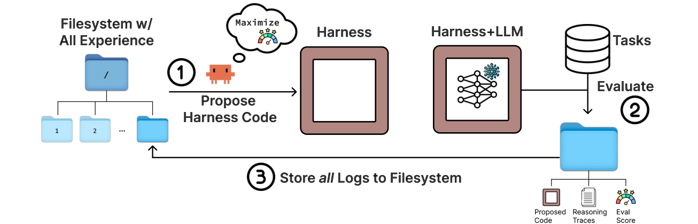
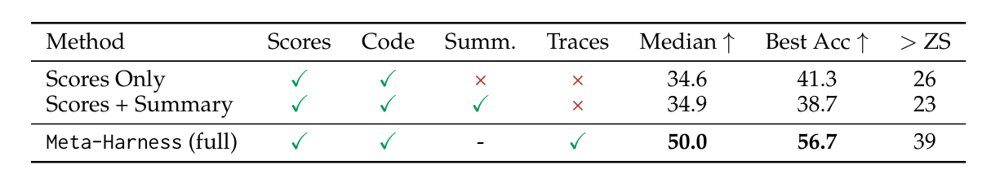

**English** | [中文](Meta-Harness_Report.zh-CN.md)

# Meta-Harness: End-to-End Optimization of Model Harnesses

Paper Review · November 23, 2026 · Jiaqi Ye · Paper: [Meta-Harness.pdf](Meta-Harness.pdf) ([arXiv](https://arxiv.org/abs/2603.28052))

## 1. Key Idea

Meta-Harness asks: **Can a coding agent optimize the harness around an LLM without changing the model weights?**

A harness determines how a model stores information, retrieves history, builds context, and carries out tasks. Traditionally, engineers inspect failures and revise rules by hand. Meta-Harness aims to automate this process through three design choices:

1. **Keep full history instead of compressing feedback.** Existing methods often reduce failures to scores or summaries. Meta-Harness keeps every candidate’s code, scores, and execution traces, so the agent can decide which details are worth examining.
2. **Retrieve past experience on demand.** When logs grow far beyond the context window, the agent searches and compares previous candidates through the file system instead of loading everything at once.
3. **Let the agent drive the search.** Rather than using fixed mutation rules, the agent diagnoses problems, edits harness code, and tests the changes.

These choices address a challenge in long-horizon tasks: an early decision about memory or execution may affect the outcome many steps later. A final score rarely explains what went wrong, while full traces make it possible to investigate the cause.

Two ideas stand out: preserving raw experience may be more useful than compressing feedback early; and a capable coding agent may be better suited to deciding what to improve than a complex set of search rules. The paper mainly offers empirical evidence for these ideas, rather than a new search algorithm.

## 2. Background & Related Work

Methods such as OPRO, TextGrad, GEPA, and AlphaEvolve already use feedback to optimize prompts or code. However, they often rely on limited history, scores, or compressed summaries, making failures in long-horizon tasks hard to trace. Meta-Harness instead preserves full execution traces so the agent can inspect and compare past cases before changing the program.

## 3. Method

### 3.1 Search Loop

With a fixed model M and task distribution X, the goal is to find the harness that achieves the highest expected task reward without changing the model weights.

*Figure 2. Meta-Harness search loop*

*The search loop has three steps: Propose (inspect history and write a candidate) → Evaluate (validate and score it independently) → Store (save code, scores, and traces). Candidates on the Pareto frontier are then selected for final testing.*

The agent handles diagnosis and code changes. One evaluation can produce up to about 10 million tokens of records, so it uses tools such as grep and cat to retrieve only what it needs. Searching directly in code allows changes to retrieval, memory, and execution logic.

The authors use Claude Code (Opus 4.6) as the proposer, with each harness written as a single Python file. A typical run involves about 20 iterations and 60 evaluations.

## 4. Experiments & Evidence

Meta-Harness improves performance across three tasks. Text classification reaches 48.6% accuracy, 7.7 percentage points above ACE, with roughly four times less context. Math reasoning improves by an average of 4.7 points across five models. TerminalBench-2 reaches a 76.4% pass rate. On nine unseen classification datasets, average accuracy is 73.1%, compared with 70.2% for ACE.

The strongest evidence comes from the ablation study: with full execution traces, the median accuracy of candidates evaluated during search increases from **34.6%** to **50.0%**, while compressed summaries provide almost no improvement. On the search set, Meta-Harness also matches the final performance of OpenEvolve and TTT-Discover in about four evaluations.

*Table 3 (ablation study). Raw execution traces help the agent optimize harnesses more effectively than pre-compressed feedback.*

The TerminalBench-2 search shows how the agent learns from failure. The first two changes reduce performance. In iteration 3, the agent notices that both failures involved the same prompt change and tests that explanation. In iteration 7, it stops changing the existing workflow and instead adds environment information before the task, finding the best harness of the run.

## 5. Strengths & Limitations

### 5.1 Strengths

**Direct experimental support.** The ablation study shows that full traces work better than scores or summaries alone, supporting the paper’s main design choice.

**Simple and inspectable.** The agent diagnoses failures and modifies harness code; the resulting changes can be reviewed and reused.

**Some evidence of generalization.** Optimized harnesses also improve results on unseen datasets and other models, suggesting that some strategies can transfer.

### 5.2 Limitations

**The source of the gains is not fully clear.** Meta-Harness changes both the amount of history available and the search process. The paper does not fully separate their contributions, and the ablation is limited to text classification.

**Generalization needs further testing.** TerminalBench-2 uses the same tasks for search and evaluation, so the resulting harness may be overfitted to that benchmark.

**Requires reliable scores and lacks continuous online improvement.** The method needs many evaluations and trustworthy feedback. After deployment, the harness does not automatically adapt to new tasks. The paper also tests only one coding-agent proposer.

## 6. Conclusion

The main lesson is that allowing an agent to revisit raw execution records as needed can make it easier to diagnose failures and improve a harness than relying only on final scores or summaries. Meta-Harness offers a promising starting point for automated harness engineering, but continuous adaptation, cost control, and generalization across tasks remain open questions.

## 7. Relevance to FunPlus Issue #27

### 7.1 Issue #27 Overview

[FunPlus Issue #27](https://github.com/evolocity-lab/funplus-GameFactory/issues/27) examines how much a self-improving loop can improve two parts of Operad, using FunPlus’s 17 visual principles as fixed evaluation standards:

- **Judge:** Improve agreement with expert verdicts and reduce INCONCLUSIVE decisions while controlling cost and latency.
- **Builder:** Use the judge’s feedback to improve game builds and see whether each round satisfies more visual principles.

A current bottleneck is missing continuous-frame evidence for motion-related principles, which leaves the judge unable to reach a verdict.

### 7.2 What Can #27 Learn from Meta-Harness?

1. **Full history does not automatically mean useful feedback.** Meta-Harness traces failures through text logs, but #27 relies on images and video that cannot be searched in the same way. Visual evidence needs to be linked to events, timestamps, and verdicts so the agent can find the relevant frames.
2. **Improve evidence collection, not just judgment.** In TerminalBench-2, the best change came from supplying environment information. Likewise, some INCONCLUSIVE results in #27 may be caused by missing frames rather than poor judgment. The judge could request more frames when needed, while the outer loop learns when to capture them, what to capture, and at what cost.
3. **Watch for the builder exploiting the judge’s blind spots.** As the builder improves against the judge’s feedback, it may learn to satisfy the judge rather than truly improve visual quality. Periodic independent expert review of sampled new builds would help establish whether higher pass rates reflect real improvements.

## References

- Lee, Y., Nair, R., Zhang, Q., Lee, K., Khattab, O., & Finn, C. (2026). Meta-Harness: End-to-End Optimization of Model Harnesses. arXiv. https://arxiv.org/abs/2603.28052
- evolocity-lab. (2026). Study visual principles with a self-improving harness on Operad (Issue #27). GitHub. https://github.com/evolocity-lab/funplus-GameFactory/issues/27
