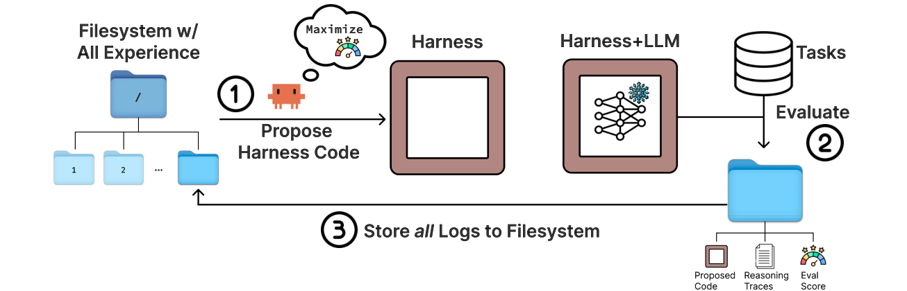
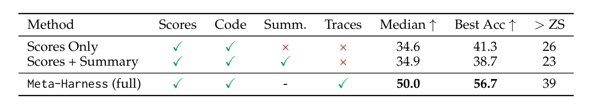

[English](Meta-Harness_Report.md) | **中文**

# Meta-Harness: End-to-End Optimization of Model Harnesses

论文汇报 · 2026年11月23日（第 7 节于 2026年11月25日更新） · Jiaqi Ye · 原文：[Meta-Harness.pdf](Meta-Harness.pdf)（[arXiv](https://arxiv.org/abs/2603.28052)）

## 1. Key Idea

Meta-Harness 研究的是：**能否让 Coding Agent 自动优化模型外围的 Harness，而不修改模型权重？**

Harness 决定模型如何存储信息、检索历史、构造上下文和执行任务。传统做法依赖工程师分析失败、修改规则；Meta-Harness 则尝试自动化这一过程，核心思路有三点：

1. **保留完整历史，而非压缩反馈。** 现有方法通常提前将失败信息压缩成分数或摘要，Meta-Harness 则保留所有候选的源码、分数和执行轨迹，让 Agent 自己判断哪些细节值得检查，而不是预先决定什么信息重要。
2. **按需检索历史经验。** 面对远超上下文窗口的日志，Agent 通过文件系统自主查阅、比较不同候选，而不需要一次性读取全部内容。
3. **让 Agent 主导搜索。** 不预设固定的变异规则，而是由 Agent 自己诊断问题、修改 Harness，并通过评测验证效果。

这些设计针对长时程任务中的一个难题：Harness 早期的信息存储或执行决策，可能在许多步骤后才影响最终结果。仅看最终分数很难定位问题，而完整执行轨迹为追溯失败原因提供了依据。

本文真正值得关注的是两个判断：一是预先压缩反馈未必比保留原始经验更有效；二是与其设计复杂的搜索规则，不如让能力足够强的 Coding Agent 根据历史经验自主决定如何改进。 论文的价值更多在于对这两种思路的实证探索，而非提出全新的搜索算法。

## 2. Background & Related Work

OPRO、TextGrad、GEPA、AlphaEvolve 等方法已能根据反馈优化 Prompt 或代码，但通常依赖有限的历史记录、分数或压缩摘要，难以追溯长时程任务中的失败原因。Meta-Harness 则保留完整执行轨迹，让 Agent 自主检索和比较历史案例，从而更有针对性地修改程序。

## 3. Method

### 3.1 Search Loop

给定固定模型 M 和任务分布 X，目标是在不更新模型权重的情况下，找到期望任务奖励最高的 Harness：

*Figure 2. Meta-Harness search loop*

*搜索循环只有三步：Propose（Agent 查阅历史并写出候选）→ Evaluate（独立程序校验并评测）→ Store（将代码、分数和轨迹写回文件系统）。搜索结束后，再从 Pareto 前沿选择候选进行最终测试。*

系统把诊断和修改权交给 Agent。单次评测最多可产生约 1000 万 Token 的记录，因此它通过 grep、cat 等工具按需读取，而不是一次处理全部历史。搜索直接发生在代码空间，可以调整检索、记忆和执行逻辑。

实现中，作者使用 Claude Code（Opus 4.6）作为 Proposer，每个 Harness 是单文件 Python 程序；典型运行约 20 轮、60 次评测。

## 4. Experiments & Evidence

Meta-Harness 在三个任务上均取得提升：文本分类准确率达到 48.6%，比 ACE 高 7.7 个百分点，上下文开销减少约 4 倍；数学推理在五个模型上平均提升 4.7 个百分点；TerminalBench-2 通过率达到 76.4%。在九个未见过的分类数据集上，平均准确率也达到 73.1%，高于 ACE 的 70.2%。

最有说服力的是消融实验： 使用完整执行轨迹后，搜索过程中候选方案的准确率中位数从 **34.6%** 提升至 **50.0%**，而使用压缩摘要几乎没有改善。Meta-Harness 也只用约 4 次评测，就在搜索集上追平了 OpenEvolve 和 TTT-Discover 的最终表现。

*Table 3（消融实验）：完整的原始执行记录，比预先压缩的反馈更有助于 Agent 优化 Harness。*

TerminalBench-2 的搜索过程展示了 Agent 如何从失败中改进： 前两轮修改都让表现变差。第三轮，Agent 发现两次失败都涉及同一处 Prompt 修改，于是尝试排除这一因素。第七轮，它不再改动原有流程，而是在任务开始前补充环境信息，最终找到了该次搜索中表现最好的 Harness。

## 5. Strengths & Limitations

### 5.1 Strengths

**有直接的实验支持。** 消融实验表明，使用完整执行轨迹比仅使用分数或摘要效果更好，支持了论文的核心设计。

**方法简单且可解释。** Agent 自主分析失败并修改 Harness 代码，具体改动可以检查和复用。

**具有一定泛化能力。** 优化后的 Harness 在未见过的数据集和其他模型上仍有提升，说明部分策略可以迁移。

### 5.2 Limitations

**性能提升的原因还不够清楚。** Meta-Harness 同时使用了更完整的历史记录和不同的搜索方式，论文没有充分区分两者各自的贡献，相关消融也只在文本分类上进行。

**跨任务泛化仍需验证。** TerminalBench-2 使用同一批任务进行搜索和评估，因此可能存在针对特定 Benchmark 的过拟合。

**依赖可靠评分，缺乏在线持续优化能力。** 方法需要大量评测和可靠的评分反馈，部署后也不会根据新任务自动改进；此外，论文只测试了一种 Coding Agent 作为优化器。

## 6. Conclusion

Meta-Harness 的启示是：比起只保存最终分数或概括性摘要，让 Agent 能够按需回看原始执行记录，更有助于定位失败并改进 Harness。它为自动化 Harness Engineering 提供了有力的起点，但在开放环境中的持续适应、成本控制和跨任务泛化仍有待验证。

## 7. Relevance to FunPlus Issue #27

### 7.1 Issue #27 Overview

[FunPlus Issue #27](https://github.com/evolocity-lab/funplus-GameFactory/issues/27) 研究的是：自我改进循环能否让 Operad 的 **Playtest** Agent 更好地判断 FunPlus 的视觉要求。范围有两点：

- **只做 Playtest。** 目标是改进 Judge，而不是改进游戏 Build；Issue 中列出的 Builder 方向目前不在范围内。
- **没有专家标注。** FunPlus 目前没有针对视觉原则或视觉建议的专家判定，因此暂时无法衡量与专家的一致率。第一步是在没有人工标注的情况下做可行性检查。

目前的主要瓶颈是动态要求缺少连续帧证据，导致 Judge 难以判断。

### 7.2 之后的进展：可行性检查

2026-11-23 会议确定的可行性检查，问的是游戏引擎能否提供数据、用代码评测视觉要求。目前已在三个引擎上针对 SSD 视觉建议完成（[#31](https://github.com/evolocity-lab/funplus-GameFactory/pull/31)：three.js 和 Cocos Creator；[#32](https://github.com/evolocity-lab/funplus-GameFactory/pull/32)：Babylon.js）。48 条建议拆成 180 个检查点，其中 168 个可以用逐帧引擎数据计算，再由视觉模型在截图上核对对象。在 Lumber Truck 上，两次完整录制中 123/125 个检查点读数一致；同一套代码在未打磨的 M12 和上线版 M21 之间找到 18 个稳定差异。

### 7.3 What Can #27 Learn from Meta-Harness?

1. **完整历史不等于有效反馈。** Meta-Harness 依靠完整轨迹定位失败，但 #27 的关键证据是图像和视频，无法像文本日志一样直接检索。因此，需要将视觉证据与事件、时间戳和判定记录关联，让 Agent 能找到真正相关的画面。#31/#32 的 engine probe 是这个方向的一步：每一帧都以文本记录（对象位置、镜头、输入），每张截图都对应一个帧号。
2. **优化取证，而不只是优化判断。** Meta-Harness 在 TerminalBench-2 上通过补充环境信息取得改进。类似地，#27 的部分 INCONCLUSIVE 可能来自证据不足，而非 Judge 判断能力不足。引擎数据能给出每一帧的运动，这是稀疏截图做不到的；外层循环可以学习记录哪些数据、何时需要截图。
3. **循环需要一个不依赖专家标注的分数。** Meta-Harness 假设每个候选都有可信的分数。没有标注时，#27 可以先用可行性检查已经产出的信号：两次录制读数是否一致、视觉模型是否在截图上确认读数、能否识别已知的版本差异（M12 vs. M21）。这些信号本身也有误差（例如视觉模型默认顾客是人，因此推翻了 Lumber Truck 中与订单卡车有关的读数），所以针对它们优化的循环同样可能过拟合。

## References

- Lee, Y., Nair, R., Zhang, Q., Lee, K., Khattab, O., & Finn, C. (2026). Meta-Harness: End-to-End Optimization of Model Harnesses. arXiv. https://arxiv.org/abs/2603.28052
- evolocity-lab. (2026). Study visual principles with a self-improving harness on Operad (Issue #27). GitHub. https://github.com/evolocity-lab/funplus-GameFactory/issues/27
- evolocity-lab. (2026). Visual guidance from engine data (PR #31, PR #32). GitHub. https://github.com/evolocity-lab/funplus-GameFactory/pull/31, https://github.com/evolocity-lab/funplus-GameFactory/pull/32
